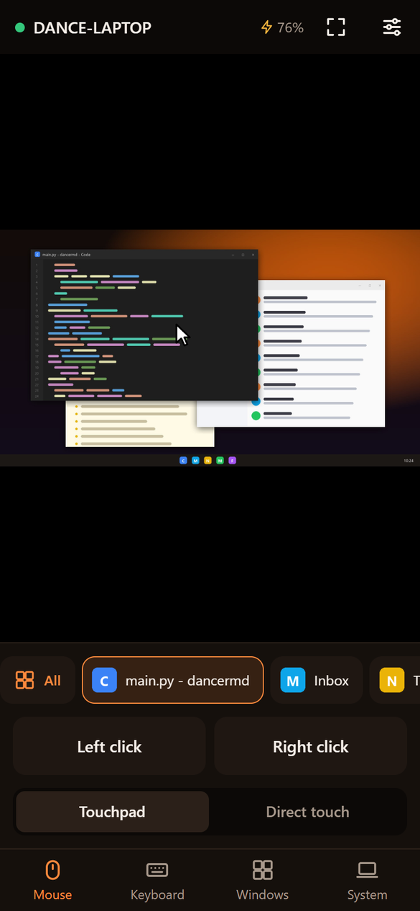
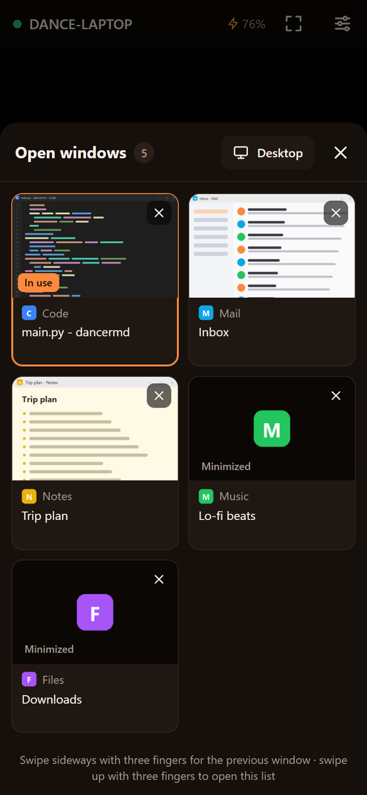
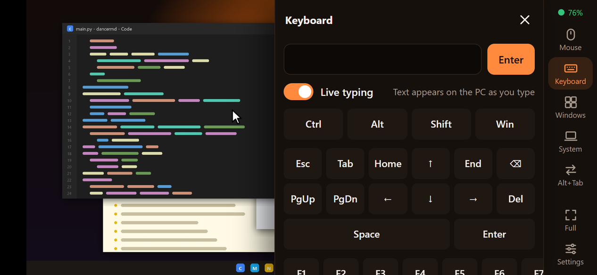

<p align="center">
  
</p>

<h1 align="center">DanceRMD</h1>

<p align="center">
  <b>Your Windows PC, at your fingertips.</b><br>
  Control a Windows laptop from any phone browser: GPU-accelerated screen streaming, a real touchpad,
  live typing in any language and an Alt+Tab window switcher. Nothing to install on the phone.
</p>

<p align="center">
  <a href="https://github.com/duypham-dev/DanceRMD/actions/workflows/ci.yml"></a>
  <a href="https://github.com/duypham-dev/DanceRMD/releases/latest"></a>
  
  
  <a href="LICENSE"></a>
</p>

<p align="center">
  <a href="https://duypham-dev.github.io/DanceRMD/">Website</a> ·
  <a href="https://github.com/duypham-dev/DanceRMD/releases/latest">Download</a> ·
  <a href="docs/architecture.md">Architecture</a> ·
  <a href="docs/protocol.md">Protocol</a> ·
  <a href="CHANGELOG.md">Changelog</a>
</p>

<p align="center">
  
  &nbsp;
  
</p>
<p align="center">
  
</p>

---

## Features

| | |
|---|---|
| **Zero install on the phone** | Scan a QR code and the phone browser becomes the remote. Works on Android and iOS. |
| **GPU pipeline** | DXGI Desktop Duplication capture and hardware H.264 encoding (NVIDIA NVENC, Intel Quick Sync, AMD AMF; x264 fallback), decoded by the phone's hardware through WebCodecs. JPEG fallback everywhere else. |
| **Adaptive streaming** | Frames are only sent when the screen changes, with credit-based flow control that matches the network speed instead of piling up latency. Low / Medium / High presets. |
| **Touch input** | Touchpad mode with acceleration, or direct touch. Tap, double-tap, two-finger right-click and scroll, pinch-zoom, long-press drag and drop. |
| **Keyboard** | Live typing that works with every phone keyboard and IME (Vietnamese, emoji…), sticky modifiers, F-keys and 20+ shortcut chips. |
| **Window switcher** | An Alt+Tab list with live thumbnails (even of covered windows), app icons, close and Show desktop. Three-finger swipes like a precision touchpad. The stream follows the window to its monitor. |
| **Landscape layout** | The PC screen takes the full width; controls live in a slim side rail with slide-out drawers. |
| **System controls** | Media keys, volume, brightness, two-way clipboard, open a link on the PC, lock / sleep / hibernate / restart / shut down with confirmations, battery status. |
| **Remote access** | One switch starts a Cloudflare quick tunnel: HTTPS from anywhere, no port forwarding, no account. |
| **Desktop app** | Dashboard window with the QR code and connected phones, tray icon with connection notifications, per-user install (no admin rights), start with Windows, optional admin mode. |
| **English and Vietnamese** | Both the phone UI and the desktop app; automatic or chosen in the settings. |

## Getting started

1. Download **`DanceRMD.exe`** from the [latest release](https://github.com/duypham-dev/DanceRMD/releases/latest) (Windows 10/11, 64-bit).
2. Open it and choose **Yes** to install. It is a per-user install: no administrator rights, and it appears in the Start menu and in *Settings > Apps*.
3. Scan the QR code in the DanceRMD window with your phone's camera.

Closing the window keeps DanceRMD running in the system tray so the phone stays connected. To exit, right-click the tray icon and choose **Quit**.

> [!NOTE]
> Release builds are not code-signed yet, so Windows SmartScreen may warn on first launch (*More info > Run anyway*). Windows Firewall also asks once whether DanceRMD may accept connections: choose **Allow**.

## Using it

### On the same Wi-Fi

The QR code points to `http://<PC address>:8765`. If the phone can't load the page, click **Open port** in the DanceRMD window (it adds a firewall rule) or use remote access below. Public networks often stop devices from seeing each other.

### From anywhere

Turn on **Remote access** in the DanceRMD window. After a few seconds the QR code switches to an `https://….trycloudflare.com` link that works over mobile data or any other network.

- It uses a [Cloudflare quick tunnel](https://developers.cloudflare.com/cloudflare-one/connections/connect-networks/do-more-with-tunnels/trycloudflare/). DanceRMD uses `cloudflared` from `PATH` or downloads the official build and verifies its Authenticode signature before running it.
- The link changes every time the tunnel starts. Copy the current one from the tray menu (*Copy connection link*). For a fixed address, use a named Cloudflare tunnel or [Tailscale](https://tailscale.com/), whose `100.x.y.z` address is listed automatically.
- HTTPS also enables H.264: browsers only expose the WebCodecs decoder to secure pages, so the plain-HTTP Wi-Fi link uses JPEG.

| | Wi-Fi link (`http://`) | Remote link (`https://`) |
|---|---|---|
| Capture | GPU (DXGI) | GPU (DXGI) |
| Encoding | JPEG | **H.264 on the GPU** |

### Switching windows

| Where | How |
|---|---|
| **Window strip** (Mouse tab) | Tap a window to bring it to the front. The active window is outlined; minimized ones are dimmed. |
| **Windows** tab or **All** | A grid with live thumbnails, app names and monitor badges. **×** closes a window; **Desktop** shows the desktop. |
| **Alt+Tab** (landscape rail) | Sends a real Alt+Tab: tap again to go back. |
| **Three-finger swipe** | Sideways = previous window, up = open the window grid. |

### Gestures

| Gesture | Touchpad mode | Direct touch mode |
|---|---|---|
| Drag one finger | Move the pointer | Pan while zoomed in |
| Tap / double-tap | Click / double-click at the pointer | Click / double-click where you touch |
| Two-finger tap | Right click | Right click |
| Two-finger drag | Scroll | Scroll |
| Pinch | Zoom (the view follows the pointer) | Zoom |
| Hold ½ s, then release / drag | Right click / drag and drop | Right click / drag and drop |
| Three-finger tap | Middle click | Middle click |

### Controlling Task Manager and elevated windows

Windows' User Interface Privilege Isolation (UIPI) stops a normal app from sending input to windows that run as administrator, such as Task Manager. When that happens the phone shows a banner naming the blocking window.

Turn on **Run as administrator** in the DanceRMD window. Windows asks for confirmation once; DanceRMD then registers a scheduled task named *DanceRMD (Admin)* and always starts elevated through it, without further prompts. That matters when you are away and the PC restarts. The lock screen and UAC prompts (the secure desktop) stay out of reach for any app that isn't a system service.

## Security

- Every connection needs the random access code embedded in the QR code. The code travels in the URL fragment, which browsers never send to servers or proxies.
- Wrong codes are rate-limited per client address (5 attempts per minute), including through the tunnel.
- The dashboard and its API answer only to this PC: loopback address **and** loopback `Host` header (DNS rebinding), no tunnel headers, and same-origin JSON for every change (CSRF).
- **Change code** disconnects every phone at once; the tray notifies you of each new connection with its real IP address.
- On the Wi-Fi link traffic is plain HTTP inside your network; through the tunnel it is HTTPS to Cloudflare, which terminates TLS.

See [SECURITY.md](SECURITY.md) for the threat model and how to report a vulnerability.

## Troubleshooting

| Symptom | What to do |
|---|---|
| *Couldn't open port 8765* | Another copy is running, for example the headless server. Close it, or start with `--port`. |
| The phone can't load the Wi-Fi link | Check both devices use the same network, click **Open port**, or use **Remote access**. |
| Remote access shows an error | Read the message under the switch. *429 Too Many Requests* means Cloudflare is rate-limiting new tunnels: wait a few minutes. Some corporate networks block `cloudflared`. |
| Still JPEG over the remote link | The browser lacks WebCodecs H.264: use a recent Chrome on Android or Safari on iOS 16.4+. |
| A yellow banner says Windows blocks input | Turn on **Run as administrator** (see above). |
| Typed Vietnamese comes out wrong | Switch the PC keyboard to English: the phone already composes the text. |
| The app closed unexpectedly | See `%APPDATA%\DanceRMD\dancermd.log`. |

## Development

Requirements: Windows 10/11 and Python 3.10+.

```bash
python -m venv .venv && .venv\Scripts\activate
pip install -r requirements-dev.txt

python -m dancermd              # desktop app from source (window + tray)
python -m dancermd --headless   # console server only, prints the QR code
pytest                          # unit and integration tests
ruff check .                    # lint
python scripts/build.py         # build dist\DanceRMD.exe (PyInstaller, about 70 MB)
```

Set `DANCERMD_HOME` to a scratch folder (and pass `--port`) to run a test copy next to an installed one; it gets its own settings and single-instance lock.

```
dancermd/
├── __main__.py      entry point: desktop app, or --headless server (cli.py)
├── config.py        settings in %APPDATA%\DanceRMD, logging
├── i18n.py          desktop strings (tray, dialogs) and language selection
├── branding.py      app icons rendered from resources/icon.jpg
├── server/          aiohttp app: routes, WebSocket session, dashboard API, access control
├── media/           DXGI/GDI capture, H.264/JPEG encoders
├── win32/           ctypes bindings: input, windows (Alt+Tab), clipboard, power, UIPI, processes
├── services/        Cloudflare tunnel, per-user installer, admin scheduled task
├── desktop/         pywebview window, tray icon, install/update/uninstall flows
├── web/             phone client, dashboard, shared i18n and locales (en, vi)
└── resources/       icon artwork, firewall script
docs/                architecture, protocol, development and release notes
scripts/             build script
tests/               pytest suite
website/             product landing page (GitHub Pages)
```

Read [docs/architecture.md](docs/architecture.md) for how the pieces fit together, [docs/protocol.md](docs/protocol.md) for the WebSocket protocol and [docs/development.md](docs/development.md) for testing, translations and releases. Contributions are welcome: see [CONTRIBUTING.md](CONTRIBUTING.md).

## Acknowledgements

DanceRMD builds on [aiohttp](https://github.com/aio-libs/aiohttp), [dxcam](https://github.com/ra1nty/DXcam), [PyAV](https://github.com/PyAV-Org/PyAV) / FFmpeg, [mss](https://github.com/BoboTiG/python-mss), [Pillow](https://python-pillow.org/), [NumPy](https://numpy.org/), [qrcode](https://github.com/lincolnloop/python-qrcode), [pywebview](https://github.com/r0x0r/pywebview), [pystray](https://github.com/moses-palmer/pystray) and [cloudflared](https://github.com/cloudflare/cloudflared).

## License

[MIT](LICENSE) © 2026 Phạm Phúc Duy
