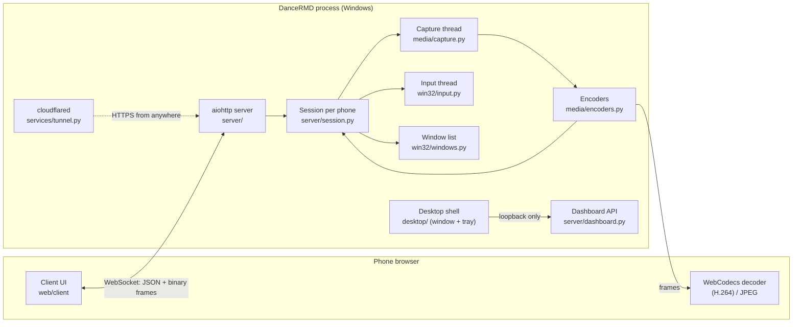

# Architecture

DanceRMD is a single Windows process that serves a web app to the phone and turns the phone's
messages into real mouse and keyboard input. This page explains how the parts fit together; the wire
format is in [protocol.md](protocol.md).

## Packages

| Package | Responsibility |
|---|---|
| `dancermd.server` | aiohttp application: routes, the WebSocket handshake (`websocket.py`), one `Session` per phone (`session.py`), the local dashboard API (`dashboard.py`), access control (`auth.py`) and shared state (`state.py`). |
| `dancermd.media` | `Capturer` grabs frames with DXGI Desktop Duplication (dxcam) and falls back to GDI (mss). `encoders.py` picks the best H.264 encoder once (NVENC, Quick Sync, AMF, then x264) and wraps JPEG. |
| `dancermd.win32` | ctypes bindings, grouped by concern: `input` (SendInput), `windows` (Alt+Tab list, icons, thumbnails, activation), `clipboard`, `system` (power, brightness, battery), `security` (integrity levels, UIPI, Authenticode), `process` (UAC elevation, job objects), `autostart`, `instance` (named mutexes). |
| `dancermd.services` | Long-running or system-level helpers: the Cloudflare quick tunnel, the per-user installer and the admin scheduled task. |
| `dancermd.desktop` | The pywebview dashboard window, the pystray tray icon, single-instance handling, install/update/uninstall flows and the migration from "Remote Laptop" 1.x. |
| `dancermd.web` | Static front end: the phone client, the dashboard and the shared translation layer. No build step and no framework. |

The server never imports the desktop shell. The shell plugs in through `server.state.Hooks`
(show the window, quit, toggle admin mode, …), which keeps the headless `--headless` mode and the
tests free of GUI dependencies.

## Threads

| Thread | Work |
|---|---|
| Main | The pywebview window (WebView2 needs the main thread). |
| `server` | The asyncio event loop: HTTP, WebSockets, sessions. |
| `capture` | One worker for everything that touches DXGI or the encoders, which are not thread-safe. Every phone shares it. |
| `input` | One worker so mouse and keyboard events keep their order. |
| `tray` | The pystray message loop. |
| Worker pool | `asyncio.to_thread` for slow, independent calls: PowerShell, clipboard, window enumeration, thumbnails. |
| `tunnel` | Reads `cloudflared` output until the tunnel is registered. |

## Life of a frame

1. `Session.stream_loop` waits until the phone has **credits** (frames it is willing to receive) and
   streaming is on.
2. On the capture thread, `Capturer.latest()` asks DXGI for a new frame. DXGI returns nothing when the
   screen hasn't changed, so an idle desktop costs almost nothing. The GDI fallback compares CRCs instead.
3. The encoder scales the frame (`VideoReformatter` with area interpolation keeps text sharp) and
   encodes it. H.264 runs with zero-latency settings, no B-frames and keyframes on demand.
4. Each frame goes out as one binary WebSocket message: a type byte followed by the payload.
5. The phone decodes it (WebCodecs for H.264, `createImageBitmap` for JPEG), draws it on a canvas and
   replies `next`, which returns a credit. The number of frames in flight is capped (2 for JPEG,
   3 for H.264), so a slow network lowers the frame rate instead of building up latency.
6. When the screen stops changing, H.264 sends a few extra frames so the encoder's quality converges.

## Input

The phone batches pointer movement per animation frame and sends relative moves (touchpad) or
normalized absolute positions (direct touch). Text uses `KEYEVENTF_UNICODE`, so any character can be
typed regardless of the PC keyboard layout. Live typing diffs the text box before and after every
input event and sends only the change, which keeps phone IMEs, autocorrect and suggestions working.

## Window switching

`win32.windows.list_windows()` applies the same rules as Alt+Tab: visible, not a tool window, not
owned, not cloaked by DWM. Icons are extracted from the executable when possible and cached per app;
thumbnails use `PrintWindow` with `PW_RENDERFULLCONTENT`, so covered and GPU-rendered windows work.
Activation tries `SetForegroundWindow`, then the Alt-key technique, then `SwitchToThisWindow`,
because Windows restricts background processes from stealing focus. "Previous window" sends a real
Alt+Tab so Windows applies its own recency order.

## Desktop lifecycle

- **Single instance**: a named mutex per data directory. A second launch asks the running copy to show
  its window through `/api/show`.
- **Install**: a downloaded `DanceRMD.exe` offers to install itself into `%LOCALAPPDATA%\Programs\DanceRMD`,
  creates shortcuts and registers an uninstall entry. Updating asks the running copy to quit
  (`/api/quit`) before replacing the file.
- **Admin mode**: creates a `HighestAvailable` scheduled task (one UAC prompt) and relaunches through it.
  At start-up an unelevated copy hands over to the task.
- **Migration**: settings of "Remote Laptop" 1.x are imported on first start (paired phones keep
  their access code), and installing removes the old shortcuts, uninstall entry and autostart value.

## Translations

The web UIs carry their own dictionaries (`web/shared/locales/*.js`). The server never sends
human-readable text: errors and notices travel as `{code, params, message}` (see
[protocol.md](protocol.md#errors-and-notices)), translated in the browser, with the English `message`
as a fallback. The desktop shell has a small dictionary in `dancermd/i18n.py`. A test checks that both
languages have the same keys and that every code raised by the server has a translation.
